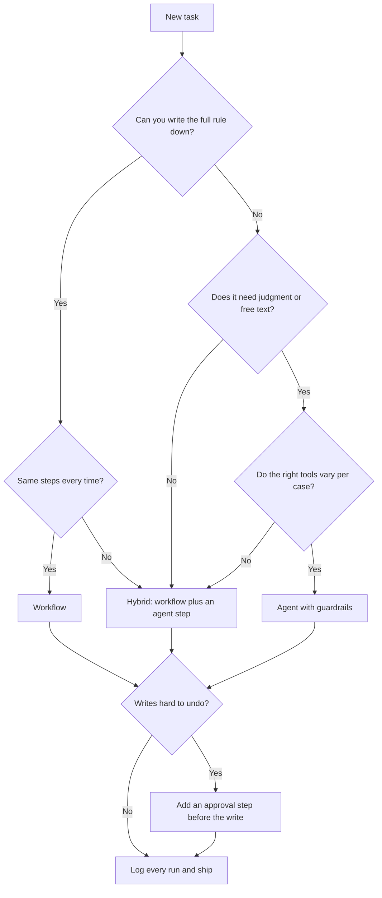

# AI agents vs workflow automation: when to use each

A decision guide with runnable code. It answers the question teams ask before they automate anything: **should this be an AI agent, a deterministic workflow, or both?**

> **Short answer:** Use a **workflow** when you can write the rule and the steps down in advance and the same input must give the same output. Use an **AI agent** when the task needs judgment, reads free text or documents, or the right tools change from case to case. Use **both** for most real jobs: a workflow for the known 90 percent and an agent for the exceptions, with an approval step before any write that is hard to undo.

## Quick comparison

| | Workflow automation | AI agent |
|---|---|---|
| Who decides the next step | You, in advance | A model, within limits you set |
| Same input, same output | Yes | Not guaranteed |
| Best at | Known rules, structured data, high volume | Judgment, messy input, varying tools |
| Cost per run | Low and predictable | Higher, varies with steps |
| Handles the unexpected | Poorly | Better |
| Audit | Steps in a log | Steps in a log plus cited evidence |
| Main risk | Wrong rule applied perfectly, silent failure | Made-up values, over-reach, duplicate writes |
| Typical safeguard | Retries, idempotency, alerts | Tool allow-list, step limit, approval before writes |

## Decision flow



Prefer a score? [`code/decision/decide.py`](code/decision/README.md) turns seven yes/no questions into one of five answers.

## Which one for common tasks

| Task | Use |
|---|---|
| Copy new CRM contacts to a database | Workflow |
| Match payment payouts to bank deposits | Workflow |
| Alert Slack when a big deal closes | Workflow |
| Fill empty CRM fields, review conflicts | Workflow first, agent for exceptions |
| Read invoice PDFs and match to purchase orders | Hybrid |
| Resolve a disputed carrier invoice | Hybrid with approval |
| Prepare a ticket escalation from three systems | Agent first, with approval |
| Answer "where is my order?" in Slack | Agent |
| Investigate why a sync is failing | Agent (your assistant, through MCP) |

## Questions this guide answers

### What is the difference between AI agents and workflow automation?
A workflow follows steps you defined, so it behaves the same way every run. An AI agent uses a model to decide which steps to take and which tools to call to reach a goal. The first is predictable and cheap at volume. The second adapts to cases you did not list.

### When should I use an AI agent instead of a workflow?
When you cannot write the rule down, when the input is free text or documents, when each case needs judgment, or when the system to consult changes per case. Examples: reading an invoice and deciding what it is, or preparing an escalation from several systems.

### When should I use workflow automation instead of an AI agent?
When the rule and the order of steps are known, the input is structured, the result must be repeatable, and volume is high. Examples: syncing records, matching on IDs and amounts, sending an alert on an event.

### What is an agentic workflow?
A workflow in which one or more steps are chosen by a model. Most teams mean one of five patterns: a workflow with one model step, a workflow with an agent for exceptions, an agent that calls vetted workflows as tools, an approval gate between the two, or an agent that graduates to a workflow. See [docs/hybrid-patterns.md](docs/hybrid-patterns.md).

### Can AI agents replace workflow automation?
Not for the known, high-volume part. A rule that runs thousands of times should not pay for a model each time, and it should give the same result every time. Agents take the work that rules cannot express. In practice they sit next to workflows.

### Is an AI agent just a workflow with an LLM?
Partly. The difference is who chooses the steps. In a workflow with an LLM step, you fix the sequence and the model fills in one value. In an agent, the model chooses the sequence. That choice is why an agent needs a tool allow-list, a step limit and approvals.

### What is the difference between an AI agent and RPA?
RPA scripts the clicks and keystrokes of a user interface. It is closer to a workflow than to an agent: fixed steps, brittle when the screen changes. An agent decides what to do and calls tools, usually APIs, not screens.

### Which is cheaper and more reliable, an agent or a workflow?
A workflow, for work it can express. It costs less per run and is repeatable. An agent costs more and varies, but handles cases a workflow cannot. Reliability for an agent comes from a narrow job, limited tools, cited evidence and approval on risky writes. See [docs/cost-and-reliability.md](docs/cost-and-reliability.md).

### How do I add human approval to an agent or a workflow?
Put an approval step before the write. The run pauses with the full payload, a reviewer approves, rejects or edits, and the run continues from where it stopped. The decision should be logged with who made it. The agent proposes, a person decides.

### How do I stop an AI agent from making mistakes in my CRM or ERP?
Give it a narrow job description, limit write access, split read tools from write tools, check for an existing record before every write, require a source for each fact, cap the number of steps and test on a sandbox copy. [`code/patterns/agent_loop.py`](code/patterns/agent_loop.py) shows these guardrails in code.

### How does an AI agent connect to business tools?
Through tool calling, commonly over the Model Context Protocol (MCP). An MCP server exposes tools, and the assistant calls them. With [Stacksync MCP](https://www.stacksync.com/mcp), Claude, ChatGPT or Cursor sign in with OAuth and build or run workflows and agents in a workspace with exactly your permissions. See [code/mcp](code/mcp/README.md).

### How do I test an AI agent?
Test behavior and guardrails, not exact text: golden cases, refusal cases, an unapproved write must not run, an unknown tool must be blocked, a loop must stop. Run the same task many times and look at the spread. See [docs/testing-and-evals.md](docs/testing-and-evals.md).

### Do I need AI to automate across my systems?
No. Two-way sync and workflows run without AI, with the same approvals and logs. Add an agent where judgment is the bottleneck.

### Why does data freshness matter for agents?
An agent that calls each app API on every question is slow and hits rate limits. Keeping a current copy of ERP and CRM records in a database through [two-way sync](https://www.stacksync.com/two-way-sync) gives the agent one place to read, and its writes flow back within the mappings you configured.

## Run the code

Python 3.9 or newer, standard library only.

```bash
cd code/decision && python -m unittest -v     # the scorecard and ten worked cases
cd ../patterns   && python -m unittest -v     # workflow, agent guardrails, hybrid
```

| Folder | What is in it |
|---|---|
| [`code/decision`](code/decision/README.md) | A seven-question scorecard, ten worked cases and a Mermaid decision tree |
| [`code/patterns`](code/patterns/README.md) | A deterministic workflow with retries and idempotency, an agent loop with guardrails, and a hybrid pipeline |
| [`code/mcp`](code/mcp/README.md) | MCP config and prompts to build each pattern from an assistant |

## Docs

- [Five hybrid patterns](docs/hybrid-patterns.md)
- [How each one fails](docs/failure-modes.md)
- [Testing a workflow and an agent](docs/testing-and-evals.md)
- [Cost, speed and reliability](docs/cost-and-reliability.md)
- [Glossary](docs/glossary.md)
- [How this maps to Stacksync](docs/stacksync-mapping.md)

## On Stacksync

Both sides exist as products that share connectors, approvals and logs: [Workflow Automation](https://www.stacksync.com/workflow-automation) for the deterministic side and [Genies](https://www.stacksync.com/ai-agents) for the agent side. Trigger availability depends on the system, connector, event and permissions, so confirm what your systems support. See [docs/stacksync-mapping.md](docs/stacksync-mapping.md).

This guide describes patterns, not guaranteed outcomes. Test on non-production data first.

## Contributing

Corrections, new cases and new patterns are welcome. See [CONTRIBUTING.md](CONTRIBUTING.md).

## License

[MIT](LICENSE)
